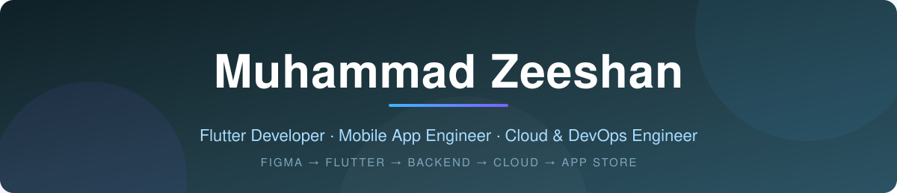
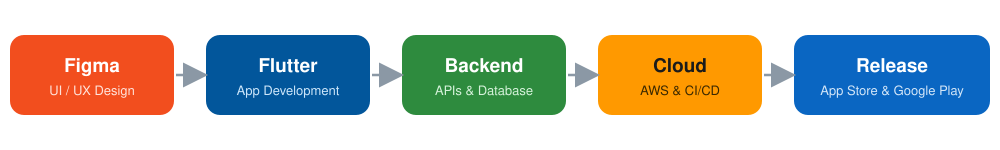

<!-- ═══════════════ HEADER BANNER ═══════════════ -->

 

  

 

---

## 👨‍💻 About Me

I'm a **Flutter developer with 4 years of experience** and **20+ mobile apps** delivered for iOS and Android.

I turn product ideas and designs into polished, production-ready applications, covering **Figma UI/UX → Flutter development → backend & API integration → cloud deployment → testing → App Store & Google Play release.**

<table>
  <tr>
    <td align="center" width="33%">
      <h3>🏗️ Build</h3>
      Develop a new mobile app from the ground up.
    </td>
    <td align="center" width="33%">
      <h3>🔧 Improve</h3>
      Fix bugs, boost performance, and stabilize an existing app.
    </td>
    <td align="center" width="33%">
      <h3>📦 Deliver</h3>
      Turn Figma designs or a prototype into a production-ready app.
    </td>
  </tr>
</table>

> 💬 *I value clear communication, maintainable code, practical architecture, and regular project updates.*

---

## 🔄 How I Work

  

---

## 🧰 What I Do

<table>
  <tr>
    <td width="50%" valign="top">

### 📱 Flutter & Mobile Development
- Cross-platform iOS & Android apps with Flutter and Dart
- Maintainable architecture with **BLoC** and **Provider**
- Firebase and REST API integration
- Push notifications and real-time features
- Email, Google, Apple, and Facebook authentication
- Payment gateway integration
- Bug fixing, performance optimization, and existing-app support
- App Store and Google Play publishing

  </td>
  <td width="50%" valign="top">

### 🎨 UI/UX & Figma
- Mobile UI/UX design, screens, and interactive prototypes
- Reusable components and design systems
- User-friendly interfaces for a range of audiences
- Design-to-development workflow with fewer handoff gaps

  </td>
  </tr>
  <tr>
    <td width="50%" valign="top">

### ⚙️ Backend & APIs
- REST API development and integration
- Node.js, Express.js, MongoDB, and Firebase
- Authentication, roles, permissions, and secure data access
- Third-party service integrations

  </td>
  <td width="50%" valign="top">

### ☁️ AWS, Cloud & DevOps
- AWS: EC2, S3, RDS, Lambda, IAM, and CloudFront
- Secure and cost-conscious cloud deployments
- Docker and containerized workflows
- CI/CD pipelines with GitHub Actions
- Deployment, monitoring, and release automation

  </td>
  </tr>
</table>

---

## 🚀 Selected Projects

<table>
  <tr>
    <td width="50%" valign="top">
      <h3>⛪ ChurchInApp</h3>
      Church community app with <b>QR check-in</b>, sermons, group messaging, prayer requests, and secure giving.
        
      
      
    </td>
    <td width="50%" valign="top">
      <h3>🩺 Radiant Notes</h3>
      Medical eLibrary for students and doctors with ebooks, MCQs, <b>timed mock exams</b>, <b>AI explanations</b>, and progress tracking.
        
      
      
    </td>
  </tr>
  <tr>
    <td width="50%" valign="top">
      <h3>🅿️ Mr Valet</h3>
      Parking management solution for a Qatar-based company with <b>5 user roles</b>, <b>5 payment methods</b>, and a <b>React admin panel</b>.
        
      
      
    </td>
    <td width="50%" valign="top">
      <h3>🎓 EduMake</h3>
      Mobile application for a <b>school-management platform</b> used by subscribed schools.
        
      
      
    </td>
  </tr>
  <tr>
    <td width="50%" valign="top">
      <h3>🔐 EasyData</h3>
      Company document-management app with <b>role-based access</b> so sensitive files stay available only to authorized users.
        
      
      
    </td>
    <td width="50%" valign="top">
      <h3>➕ More Apps</h3>
      Fuel station app 
      Cricket ground ticket booking 
      Golf cart booking
        
      
    </td>
  </tr>
</table>

🔒 Some projects are client-owned, so public demos or source code may not be available.

---

## 🛠️ Tech Stack

**📱 Mobile** 

**⚙️ Backend & Data** 

**☁️ Cloud & DevOps** 

**🎨 Design & Dev Tools** 

---

## 🎓 Certifications

  
  

---

## 📊 GitHub

  

<!-- OPTIONAL: after running the metrics workflow once, uncomment the line below -->
<!--  -->

---

## 🤝 Let's Work Together

Have an app idea, an existing Flutter project that needs attention, or Figma designs ready for development?

**Send me a message with:**

1. 📝 A short description of your project
2. 🔗 Your Figma link or current app link (if available)
3. 📱 Whether you need iOS, Android, or both

I'll reply with a **practical approach, estimated timeline, and clear next steps.**

  

[💼 LinkedIn](https://www.linkedin.com/in/muhammad-zeeshan-1326242b7) &nbsp;•&nbsp; [🦋 Bluesky](https://bsky.app/profile/ZeeshanDev) &nbsp;•&nbsp; [🐙 GitHub](https://github.com/ZeeshanUop)

 

<!-- ═══════════════ FOOTER ═══════════════ -->

<i>Thanks for visiting my profile! ⭐</i>

 

